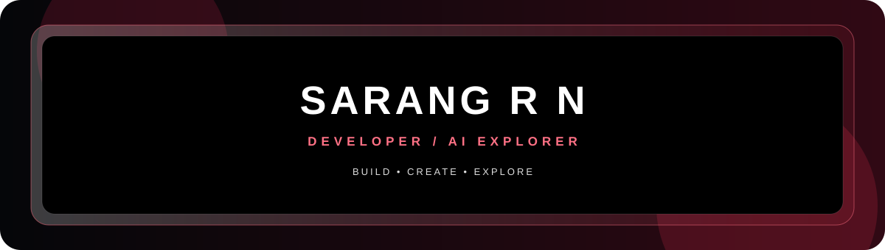
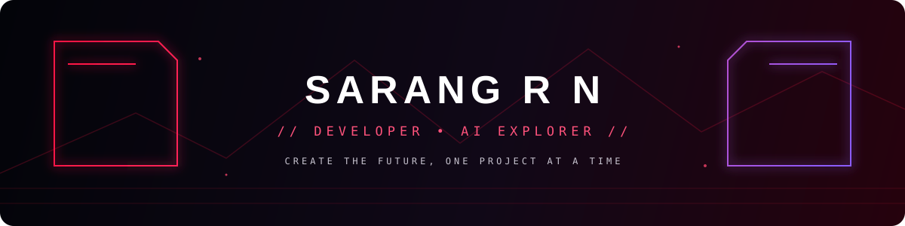

<h1 align="center">🌸 Hi, I'm SARANG R N</h1>

  

  

  
  

  

## 🌸 About Me

Python | Java | React | Machine Learning

- 🌐 Website: https://saranghaeyong.github.io/OPEN-PORTFOLIO/
- 📍 Location: ERNAKULAM, KERALA

## ⚙️ Tech Stack

## 📊 GitHub Stats

  
  

## 🔥 Contribution Streak

---

## approach

I like turning ideas into practical digital experiences. My work and experiments span web development, Android TV interfaces, AI-assisted tools, and open-source software. I focus on clean interfaces, useful features, and learning by building.

## selected case studies

- [SRNTV Launcher](https://github.com/saranghaeyong/SRNTV-Launcher) — An Android TV launcher concept focused on an AMOLED-friendly interface, custom typography, and a clean viewing experience.
- [SRNCineHUB](https://github.com/saranghaeyong/SRNCineHUB) — A cinema and entertainment-focused project exploring movie discovery and media experiences.
- [Portfolio](https://saranghaeyong.github.io/OPEN-PORTFOLIO/) — A personal space to present my work, projects, and developer profile.

## writing & talks

Writing and talk links will be added here as they are published.

---

  For project enquiries: <a href="https://saranghaeyong.github.io/OPEN-PORTFOLIO/">get in touch through my portfolio</a>

---

  

### // whoami

I'm an MCA graduate and developer from Kerala, India, interested in building useful software and exploring creative technology. I enjoy working across web development, AI-assisted tools, Android TV experiences, and open-source projects.

### // currently

- Building and refining Android TV and media-focused projects.
- Exploring AI tools, automation, and practical developer workflows.
- Experimenting with modern web interfaces, Linux, and open-source software.

### // contact

[Portfolio](https://saranghaeyong.github.io/OPEN-PORTFOLIO/) · [GitHub @saranghaeyong](https://github.com/saranghaeyong)

  <i>Thanks for visiting — build, create, explore.</i>

