  

  

  
  
  

---

## ⚡ // whoami

I'm an **MCA Graduate** and software developer based in **Kerala, India**. I specialize in building practical, high-performance applications across web development, Android TV systems, and AI-assisted tools. I thrive on translating abstract concepts into clean, minimalist digital interfaces with an AMOLED dark aesthetic.

- 📍 **Location:** Ernakulam, Kerala, India
- 🎓 **Education:** Master of Computer Applications (MCA)
- 🌐 **Portfolio:** [saranghaeyong.github.io/OPEN-PORTFOLIO](https://saranghaeyong.github.io/OPEN-PORTFOLIO/)
- 💡 **Philosophy:** Build with purpose, design with precision, explore continuously.

---

  

---

## 🛠️ // technical stack

### 💻 Programming Languages

### 🚀 Frameworks & Libraries

### 🗄️ Databases & Storage

### ⚙️ Development Tools & OS

  

## 🚀 // featured projects

Here are some of my key public repositories showcasing different areas of software engineering:

| Project | Description | Tech Stack |
| :--- | :--- | :--- |
| **[SRNTV-Launcher](https://github.com/saranghaeyong/SRNTV-Launcher)** | Minimalist Android TV home screen with pure black interface, crimson accents, and fluid D-pad navigation. | `Kotlin` `Android TV` |
| **[3d-portfolio](https://github.com/saranghaeyong/3d-portfolio)** | Interactive 3D portfolio designed as a virtual desktop experience with windows and animations. | `TypeScript` `Three.js` `React` |
| **[OPEN-PORTFOLIO](https://github.com/saranghaeyong/OPEN-PORTFOLIO)** | Personal developer portfolio showcasing projects, technical skills, and software experiments. | `TypeScript` `Tailwind CSS` |
| **[sarangify](https://github.com/saranghaeyong/sarangify)** | Android application built for streaming music seamlessly from YouTube Music. | `Kotlin` `Android` |
| **[headphone](https://github.com/saranghaeyong/headphone)** | Immersive interactive product showcase featuring custom audio gear concepts. | `TypeScript` `Tailwind CSS` |

---

## 📈 // contribution activity

  

  
  

  

---

## 🔭 // currently exploring

- **Advanced AI Tooling:** Exploring local LLM integrations, automated code generation agents, and intelligent CLI workflows.
- **Immersive Web Interfaces:** Experimenting with WebGL, CSS shaders, and fluid motion design in browser applications.
- **Android TV Ecosystem:** Refining lightweight, distraction-free television launchers and custom media clients.

---

## 📬 // connect with me

  
  

  

