<!-- 🎬 HERO BANNER -->

  

<!-- 👤 ABOUT ME -->

  

<!-- ⚔️ WEAPONS ARSENAL -->

  

<!-- 📋 FEATURED MISSIONS -->

  

<!-- 💬 CONNECT -->

---

## 🔥 GitHub Stats

  
  

---

## 🏆 Contribution Graph

*My commit activity visualised — updated daily by GitHub Actions.*

  <a href="https://github.com/saranghaeyong">Contribution graph unavailable — check back later.</a>

---

## 📌 Featured Projects

| Project | Description | Tech Stack |
|---|---|---|
| [SRNTV-Launcher](https://github.com/saranghaeyong/SRNTV-Launcher) | Minimalist Android TV home screen with pure black interface, crimson accents, and fluid D‑pad navigation. | `Kotlin` `Android TV` |
| [3d-portfolio](https://github.com/saranghaeyong/3d-portfolio) | Interactive 3D portfolio designed as a virtual desktop experience with windows and animations. | `TypeScript` `Three.js` `React` |
| [OPEN-PORTFOLIO](https://github.com/saranghaeyong/OPEN-PORTFOLIO) | Personal developer portfolio showcasing projects, technical skills, and software experiments. | `TypeScript` `Tailwind CSS` |
| [sarangify](https://github.com/saranghaeyong/sarangify) | Android application built for streaming music seamlessly from YouTube Music. | `Kotlin` `Android` |
| [headphone](https://github.com/saranghaeyong/headphone) | Immersive interactive product showcase featuring custom audio gear concepts. | `TypeScript` `Tailwind CSS` |

<a href="https://github.com/saranghaeyong?tab=repositories">→ See all repositories</a>

---

## 🧠 Currently Exploring

<ul style="list-style:none;padding:0;">
  <li style="padding:4px 0;">▸ Advanced AI Tooling — local LLM integrations, automated code generation agents, intelligent CLI workflows</li>
  <li style="padding:4px 0;">▸ Immersive Web Interfaces — WebGL, CSS shaders, and fluid motion design in browser applications</li>
  <li style="padding:4px 0;">▸ Android TV Ecosystem — lightweight, distraction-free television launchers and custom media clients</li>
</ul>

---

## 📮 Connect with Me

| Platform | Link |
|---|---|
| **GitHub** | https://github.com/saranghaeyong |
| **LinkedIn** | TODO_LINKEDIN_URL |
| **Portfolio** | [pbgm.vercel.app](https://pbgm.vercel.app/) |
| **Email** | TODO_EMAIL |

  
  
  

  

  

    ◆ MCA Graduate · Fresher · Seeking opportunities in Kerala, India ◆
  

  

    "Maximum effort. Minimum bugs."
  

  
Built with ❤️ and a lot of coffee

